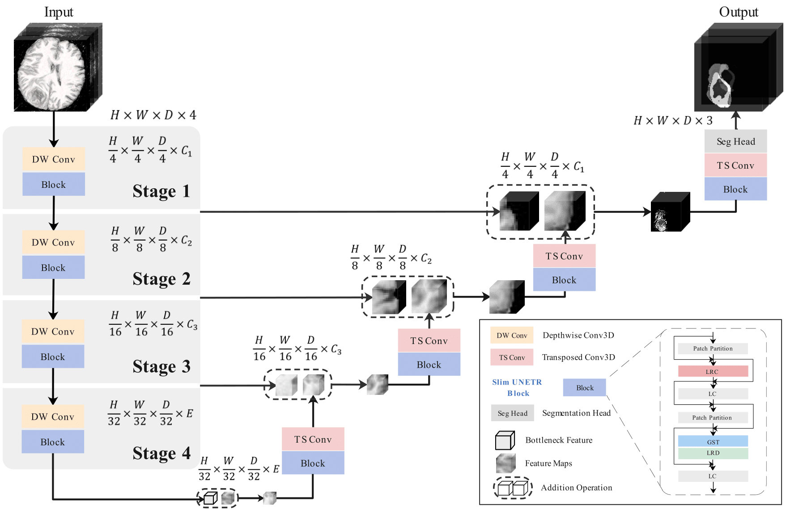

# Slim UNETR — Local MRI Segmentation Demo

> Received this as a handoff? Start with [HANDOFF.md](HANDOFF.md) (what was done, one-script setup, saved evidence). The Git clone steps below are not needed for the zip route.

Run the authors' pretrained **Slim UNETR** model on a real four-modality 3D brain MRI, inspect tumour predictions in a local browser, and download masks and a run report. A real **MRI case and reference annotation are included**, so a fresh clone needs no full-dataset download to demonstrate inference.

An optional **BRISC SegFormer-B5** extension supports individual JPG/PNG T1 MRI slices. It is a separate model; its outputs are not Slim UNETR paper results.

| Workflow | Input | Output |
| --- | --- | --- |
| **Paper model: Slim UNETR** | Four aligned 3D modalities, or one four-channel NIfTI | Tumour core (TC), whole tumour (WT), enhancing tumour (ET) |
| Optional 2D extension | One JPG/PNG T1 MRI slice | One binary tumour mask |

Inference runs on your laptop. No training or external inference service is required. A reference mask is needed only to calculate comparison metrics.



## Requirements

- **Python 3.11, 64-bit**, and [Git](https://git-scm.com/downloads).
- Windows is the locally verified platform. Linux/macOS paths are provided below; those operating systems have not been exercised here.
- CPU works; a compatible NVIDIA GPU is optional. Allow at least 8 GB RAM (16 GB recommended) and about 4 GB free disk for installation/results. The UI requires 2 GB free before accepting a prediction.
- Internet is needed for package/model setup. Prediction then works offline.

Commands use the virtual environment's Python directly, so PowerShell activation or execution-policy changes are unnecessary. New installations use pinned PyTorch 2.6.0 and application dependencies. Your original laptop's working environment can still run the app without reinstalling it.

## Windows PowerShell: fresh clone to live demo

### 1. Clone the repository

```powershell
git clone https://github.com/srkxspace-pixel/Slim-UnetR-.git
Set-Location '.\Slim-UnetR-'
```

### 2. Create an isolated environment

```powershell
py -3.11 -m venv .venv
```

If `py` is unavailable, install Python 3.11 from [python.org](https://www.python.org/downloads/), reopen PowerShell and check `py -3.11 --version`.

### 3. Install the CPU runtime and app

```powershell
& .\.venv\Scripts\python.exe -m pip install torch==2.6.0 --index-url https://download.pytorch.org/whl/cpu
& .\.venv\Scripts\python.exe -m pip install -r .\requirements-ui.txt
& .\.venv\Scripts\python.exe -m pip check
```

No NVIDIA GPU is needed. For an NVIDIA GPU compatible with CUDA 12.4, use this **instead of the CPU torch installation**, then install `requirements-ui.txt` as above:

```powershell
& .\.venv\Scripts\python.exe -m pip install torch==2.6.0 --index-url https://download.pytorch.org/whl/cu124
```

See the [official PyTorch builds](https://pytorch.org/get-started/previous-versions/#v260). Drivers/GPU compatibility vary; CPU is the default setup. The original development GPU environment was PyTorch 2.5.1+cu121; the new 2.6.0 CUDA build has not been separately GPU-tested here.

### 4. Download the verified pretrained weights

```powershell
& .\.venv\Scripts\python.exe -u .\setup_demo.py
```

This verifies the included MRI/reference and downloads the authors' roughly **7 MB** BraTS2021 checkpoint. Matching files are reused, hashes are checked, and failed downloads are not installed. Weights live in ignored `model_store/`; they are not committed to Git.

### 5. Start the app

```powershell
& .\.venv\Scripts\python.exe -u .\local_ui.py --device cpu --open-browser
```

Keep the terminal open. In Chrome or Edge open **http://127.0.0.1:8765** and wait for the 3D model to be ready. The first load/prediction takes longer. Omit `--device cpu` to select available CUDA automatically.

### 6. Run the actual 3D model live

For an immediate rehearsal click **Run real local example · BRATS_409**. It reads the bundled files and runs a new prediction; it does not substitute a saved result.

For a manual-upload demonstration:

1. Select **One 4D file**.
2. MRI: choose **`examples/BRATS_409/image.nii.gz`**.
3. Expand **Reference mask — optional** and choose **`examples/BRATS_409/reference.nii.gz`**.
4. Select **MSD Task01** as the reference label scheme.
5. Read and tick the modality confirmation, then click **Run prediction**.
6. Inspect axial/coronal/sagittal slices, modalities, TC/WT/ET and opacity. Compare with the reference and download the result ZIP/report.

This real image contains **FLAIR → T1 → T1 contrast → T2** channels. Reference labels are **0 background, 1 edema, 2 non-enhancing tumour, 3 enhancing tumour**. See [sample identity, hashes and data license](examples/BRATS_409/README.md).

Repeat without a reference to demonstrate prediction on an unannotated case; no accuracy scores will appear. For a new MRI case request the same four acquired modalities, already aligned/skull-stripped, with valid matching grids and millimetre units. The app does not register images or infer modality identity from names.

### 7. Stop and restart

Press **Ctrl+C** in the terminal. On later days only run:

```powershell
Set-Location 'C:\path\to\Slim-UnetR-'
& .\.venv\Scripts\python.exe -u .\local_ui.py --open-browser
```

Replace the folder with your actual clone location. Double-clicking `run_local_ui.cmd` also works after setup. If a previous server occupies the port, stop it or use `--port 8766` and open that port in the browser.

## Terminal-only 3D demo

```powershell
& .\.venv\Scripts\python.exe -u .\demo.py --device cpu
```

Runs fresh inference on the bundled MRI/reference, prints metrics, and saves MRI/reference/prediction PNGs, NIfTI masks, a ZIP and `report.json` in a new timestamped `outputs/demo_*` directory. Use `--device cuda` to require CUDA, or `--output-dir outputs/my_rehearsal` to choose a **new** directory. Existing results are never overwritten.

## Optional JPG / PNG extension

```powershell
& .\.venv\Scripts\python.exe -m pip install -r .\requirements-2d.txt
& .\.venv\Scripts\python.exe -u .\setup_demo.py --with-2d
```

Start the app and select **JPG / PNG slice**. Upload one clean individual **T1-weighted brain MRI slice**, preferably contrast-enhanced. The first request loads the separate BRISC model, which downloads about 352 MB during setup. An optional same-size binary **PNG** reference enables slice Dice/IoU: 0 = background, 1 or 255 = tumour. This mode cannot supply TC/WT/ET, physical volume or millimetre HD95 from a picture. Other sequences and arbitrary screenshots are unvalidated.

Use a suitable research image or follow [advanced 2D testing](docs/TESTING.md) for public JPG/reference sample acquisition. The bundled 3D case alone is sufficient for the original-paper demonstration.

## Linux / macOS CPU setup

```bash
git clone https://github.com/srkxspace-pixel/Slim-UnetR-.git
cd Slim-UnetR-
python3.11 -m venv .venv
# Linux CPU wheel; on macOS omit the --index-url option.
.venv/bin/python -m pip install torch==2.6.0 --index-url https://download.pytorch.org/whl/cpu
.venv/bin/python -m pip install -r requirements-ui.txt
.venv/bin/python setup_demo.py
.venv/bin/python local_ui.py --device cpu --open-browser
```

These commands are provided for portability; local verification was on Windows. The engine uses CPU/CUDA, not Apple MPS.

## Outputs, limits and recovery

- UI results are saved in **`outputs/ui_runs/<run-id>/`**. Reports record model/input hashes, settings, timings and actual reference-based metrics.
- 3D masks use **preprocessed RAS orientation / 1 mm spacing**, not necessarily the acquisition grid. Use `FLAIR_processed.nii.gz` as their background. TC/WT/ET remain independent overlapping binary masks.
- Completed runs reconnect after a browser refresh on the same origin. Interrupted predictions must be resubmitted. Uploads and failed runs remain locally; no automatic deletion occurs.
- One case runs at a time. Before accumulating 20 UI runs, stop the app and archive older run folders. Keep at least 2 GB free. Uploaded scans and outputs are ignored by Git.
- On GPU-memory failure restart explicitly with `--device cpu`. The app does not stop other programs or silently switch devices mid-prediction.
- Predictions can miss tumours or mark healthy tissue. An empty mask does not rule out tumour. This is a research demonstration, not a clinical tool.

## Tests and evaluation claims

```powershell
& .\.venv\Scripts\python.exe -m unittest discover -s tests -p 'test_*.py'
```

With the server running, use another terminal to run `python verify_local_ui.py`. It exercises real uploads in both 3D formats, references, planes, downloads and request protection. See [testing](docs/TESTING.md) and [live presentation notes](docs/DEMO.md).

A clean clone in a newly installed Windows CPU environment passed all 23 tests, real inference and HTTP integration checks. The bundled case's masks matched the earlier GPU result exactly. See [verification evidence and remaining platform limits](docs/VERIFICATION.md).

We demonstrate the **authors' released architecture and weights**; we do **not** claim reproduction of the paper's **92.44% BraTS2021 benchmark**. The bundled case is MSD Task01, with unverified overlap against checkpoint training. Historical local MSD scores and 2D slice scores have separate experimental scope. See [evaluation/cross-verification](docs/EVALUATION.md).

## Project structure

```text
local_ui.py             Localhost HTTP app
demo.py                 Fresh terminal-only 3D demo
setup_demo.py           Verified model setup
src/SlimUNETR/          Original released network architecture
src/local_inference.py  Frozen 3D inference and volume validation
src/slice_inference.py  Optional 2D inference and image validation
ui/                    Browser interface
examples/BRATS_409/     Attributed real MRI/reference pair
tests/                 Regression and input-boundary tests
docs/                  Demo, evaluation, provenance and testing guides
```

Upstream training/profiling scripts remain for research context. They are not needed for the demo. Training needs the full dataset and optional `requirements-training.txt`; it has not been revalidated as part of this inference app. The original `inference.py` includes optimizer warm-up, so use the UI or `demo.py` for frozen inference. Historical review scripts require locally generated result archives.

## Attribution and licensing

The original Slim UNETR code retains its [MIT license](LICENSE), copyright deepang-ai. The bundled MRI/reference are **CC BY-SA 4.0**; optional model weights have separate terms. See [NOTICE](NOTICE.md).

**Paper:** Pang et al., *Slim UNETR: Scale Hybrid Transformers to Efficient 3D Medical Image Segmentation Under Limited Computational Resources*, IEEE TMI 43(3), 994–1005, [DOI:10.1109/TMI.2023.3326188](https://doi.org/10.1109/TMI.2023.3326188). [Authors' repository](https://github.com/deepang-ai/Slim-UNETR) · [official release](https://github.com/deepang-ai/Slim-UNETR/releases/tag/v1.0.0) · [preserved upstream README](docs/UPSTREAM_README.md).
